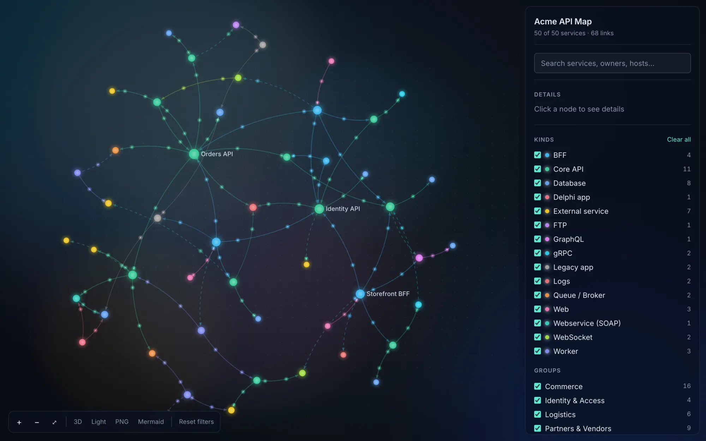
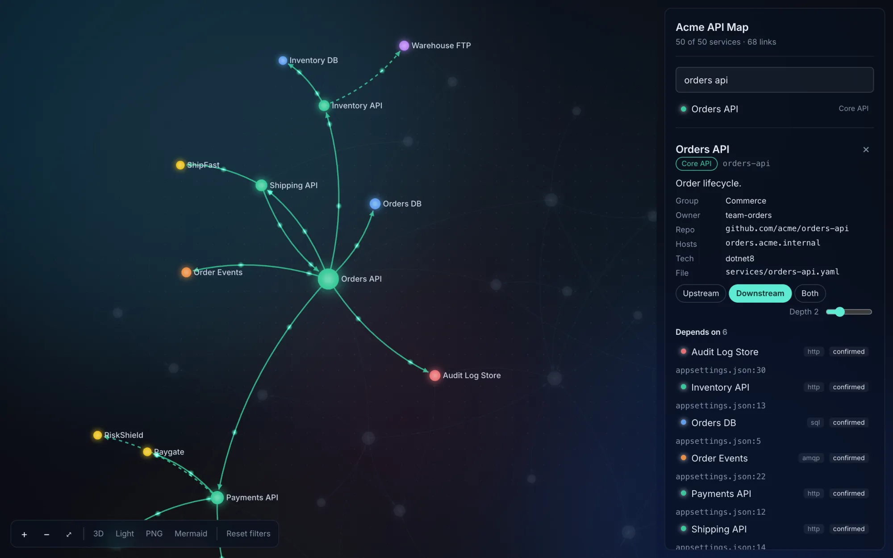
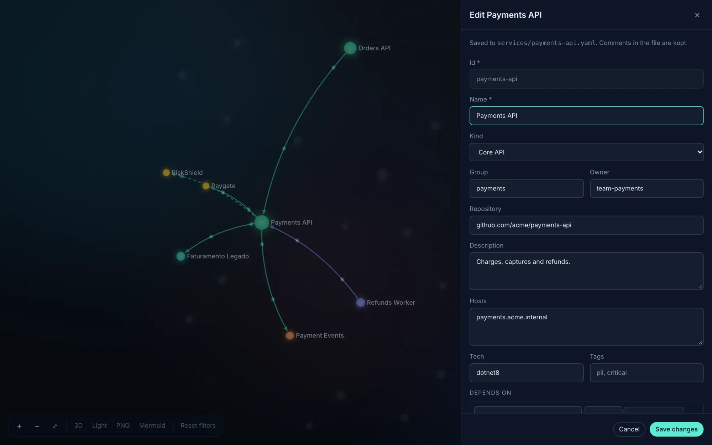
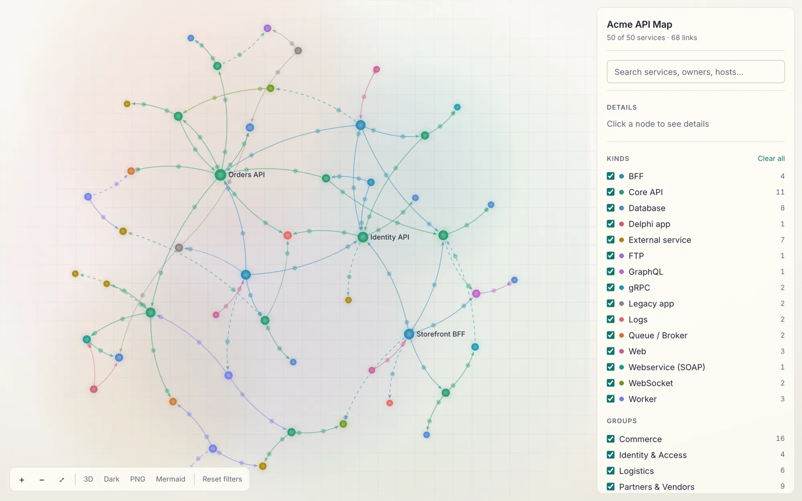
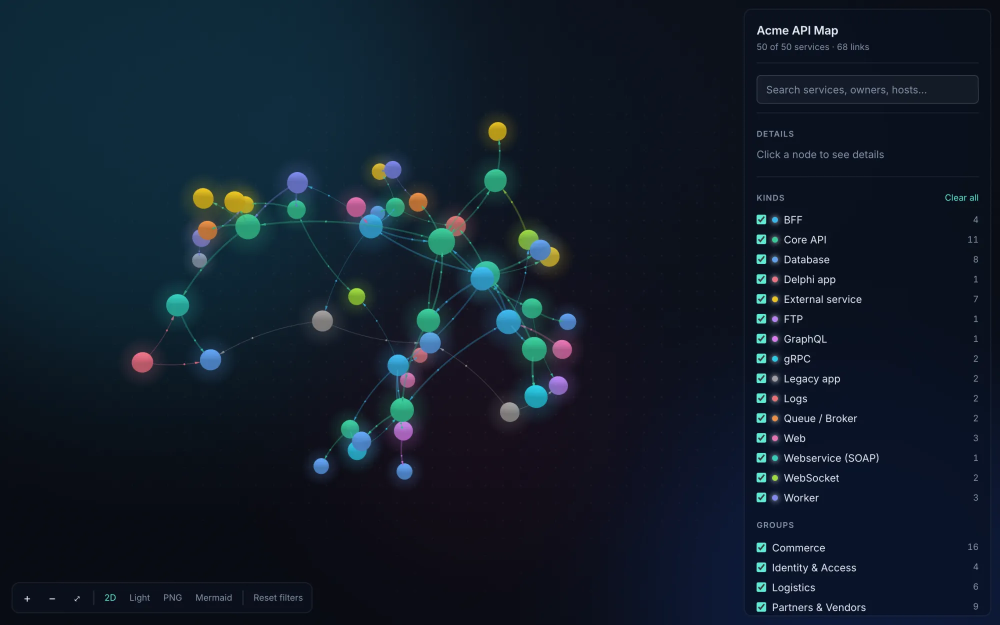
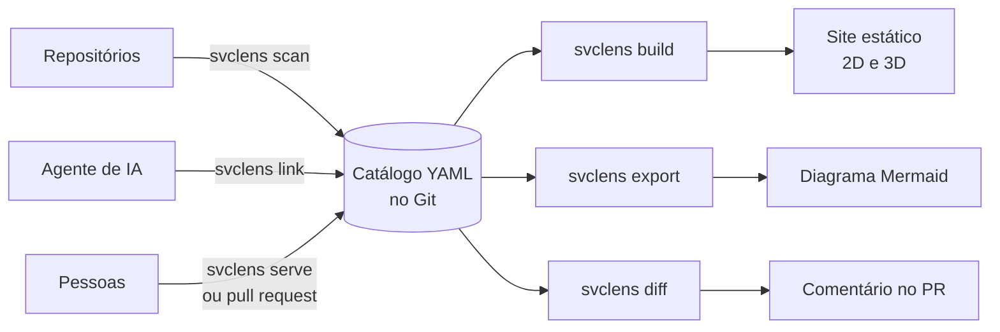
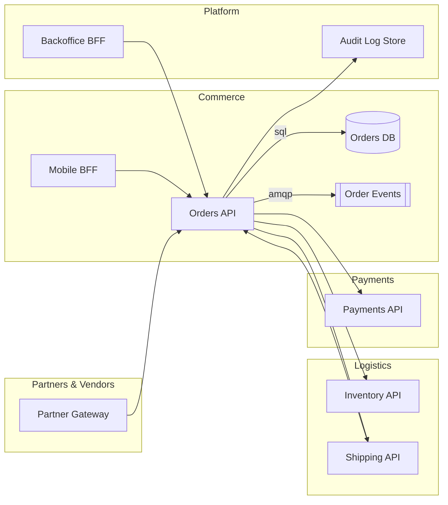

<div align="center">

<h1>
  <picture>
    <source media="(prefers-color-scheme: dark)" srcset="docs/assets/logo-dark.svg">
    
  </picture>
</h1>

<strong>Mapa interativo das APIs de uma empresa e de como elas se chamam, montado a partir do código.</strong>

<p>
Os serviços ficam em arquivos YAML no Git. O <code>svclens</code> lê os repositórios para preencher as dependências, desenha o grafo em 2D ou 3D e mostra, em cada ligação, onde ela foi encontrada.
</p>

<p>
  <a href="https://github.com/SidneyJunior26/svclens/actions/workflows/ci.yml"></a>
  <a href="https://www.npmjs.com/package/svclens"></a>
  <a href="LICENSE"></a>
  
</p>

<a href="https://sidneyjunior26.github.io/svclens/"><strong>Demonstração ao vivo</strong></a>
· <a href="#instalação">Instalação</a>
· <a href="#primeiros-passos">Primeiros passos</a>
· <a href="#como-funciona">Como funciona</a>
· <a href="#descoberta-automática">Descoberta</a>
· <a href="#editor-local-e-propostas-por-pull-request">Editor</a>
· <a href="#perguntas-frequentes">Perguntas</a>

</div>

<p align="center">
  <a href="https://sidneyjunior26.github.io/svclens/">
    
  </a>
  <br>
  <sub>Catálogo de demonstração com dados fictícios. Na versão ao vivo dá para clicar nos serviços.</sub>
</p>

## Por que existe

Em empresas grandes, o número de serviços cresce mais rápido do que a documentação. Um time cria um BFF novo, outro passa a consumir uma API core por um atalho, um worker começa a ler uma fila que ninguém lembrava que existia, e o webservice SOAP de dez anos atrás continua recebendo chamadas de um sistema em Delphi. Cada mudança faz sentido isolada. Somadas, deixam a empresa sem uma resposta confiável para perguntas simples:

- Se eu mudar o contrato desta API, quem quebra?
- Este fornecedor ficou fora do ar. Quais sistemas param junto?
- Ainda tem alguém chamando o serviço que queremos desligar?
- Por onde passa uma requisição do app até o banco de dados?

Hoje quem responde é alguém que está há anos na empresa, ou um diagrama no wiki que ficou desatualizado na semana seguinte. Ferramentas de observabilidade mostram o tráfego que aconteceu, mas não cobrem o que roda uma vez por mês, o que está em homologação ou o que só aparece numa connection string.

O svclens guarda essa informação junto do código, num formato que dá para revisar em pull request, e mostra cada ligação com a evidência de onde ela veio.

## O que ele faz

<table>
  <tr>
    <td width="50%" valign="top">
      <b>Catálogo em YAML</b><br>
      Um arquivo por serviço, no repositório do código ou num repositório só para o mapa. Uma mudança no mapa vira diff e passa por revisão como qualquer outra.
    </td>
    <td width="50%" valign="top">
      <b>Descoberta nos repositórios</b><br>
      O scan lê arquivos de configuração (inclusive `Web.config` legado e `appsettings`), projetos .NET e Node, OpenAPI e docker-compose, e preenche as dependências sem apagar o que foi escrito à mão.
    </td>
  </tr>
  <tr>
    <td width="50%" valign="top">
      <b>Evidência em cada ligação</b><br>
      Toda seta diz se foi confirmada no código, inferida por um agente de IA ou cadastrada por uma pessoa, e aponta o arquivo e a linha em que apareceu.
    </td>
    <td width="50%" valign="top">
      <b>Grafo 2D e 3D</b><br>
      Busca, filtros por tipo e grupo, e a visão de impacto: quem depende de um serviço (upstream) e do que ele depende (downstream), na profundidade que você escolher.
    </td>
  </tr>
  <tr>
    <td width="50%" valign="top">
      <b>Edição sem abrir o YAML</b><br>
      O editor local grava direto nos arquivos. No site publicado, o botão de propor mudança leva ao GitHub, e o pull request sai de lá.
    </td>
    <td width="50%" valign="top">
      <b>Saídas prontas para documentar</b><br>
      Diagrama Mermaid para colar no README, imagem PNG da tela atual e um diff entre versões do catálogo para comentar em pull requests.
    </td>
  </tr>
</table>

## Veja funcionando

<table>
  <tr>
    <td width="50%" valign="top">
      
      <br><sub>Clique num serviço para ver o que ele chama. Cada dependência mostra o protocolo, a confiança e o arquivo onde apareceu.</sub>
    </td>
    <td width="50%" valign="top">
      
      <br><sub>O editor local grava no arquivo do serviço e preserva os comentários do YAML.</sub>
    </td>
  </tr>
  <tr>
    <td width="50%" valign="top">
      
      <br><sub>Tema claro, para quem vai imprimir ou colar a imagem num documento.</sub>
    </td>
    <td width="50%" valign="top">
      
      <br><sub>Modo 3D, pensado para apresentações. Filtros e busca valem nos dois modos.</sub>
    </td>
  </tr>
</table>

## Instalação

Precisa do Node.js 20 ou mais novo.

```bash
npm install -g svclens
svclens --version
```

Para usar sem instalar, troque `svclens` por `npx svclens` nos comandos abaixo.

<details>
<summary>Instalar a partir do código-fonte</summary>

```bash
git clone https://github.com/SidneyJunior26/svclens.git
cd svclens
pnpm install
pnpm build
pnpm svclens --version
```

Com o pnpm, o comando é `pnpm svclens` dentro da pasta do repositório.

</details>

## Primeiros passos

### 1. Crie uma pasta com um serviço

```
meu-catalogo/
  services/
    orders-api.yaml
```

```yaml
# services/orders-api.yaml
id: orders-api
name: Orders API
kind: core
owner: team-orders
hosts: [orders.acme.internal]
dependsOn:
  - target: payments-api
    protocol: http
```

O `kind` define a cor e a forma no grafo. Os tipos nativos são `bff`, `core`, `web`, `worker`, `webservice`, `websocket`, `grpc`, `graphql`, `queue`, `database`, `ftp`, `logs`, `external` e `legacy`. Dá para criar outros na configuração.

### 2. Confira se está tudo certo

```bash
svclens validate meu-catalogo
```

### 3. Abra o editor e o grafo

```bash
svclens serve meu-catalogo --open
```

### 4. Deixe o svclens descobrir o resto

Aponte as pastas (ou URLs git) dos repositórios no `svclens.config.yaml` e rode o scan. Os detalhes estão em [Descoberta automática](#descoberta-automática).

```bash
svclens scan meu-catalogo
```

### 5. Publique

O comando abaixo gera um site estático que pode ir para o GitHub Pages, um bucket S3 ou um servidor interno.

```bash
svclens build meu-catalogo     # site em meu-catalogo/dist
```

> [!TIP]
> Quer ver antes de montar o seu? Clone o repositório e rode `pnpm svclens serve examples/acme-demo --open`. É o mesmo catálogo fictício da demonstração.

## Como funciona



Três coisas escrevem no catálogo: o scan, um agente de IA e uma pessoa. Cada ligação guarda quem a escreveu, e isso decide o que acontece no próximo scan.

| Confiança | Origem | Como aparece | O que o scan faz com ela |
| --- | --- | --- | --- |
| `confirmed` | `scan` | Seta cheia | Recria a cada execução e remove se o código deixou de citar o serviço |
| `inferred` | `agent` | Seta tracejada | Não mexe |
| `manual` | `manual` | Seta fina | Não mexe |

Serviços que aparecem como alvo mas não têm arquivo viram um nó tracejado ("fantasma"). Assim a ligação não some só porque falta um cadastro. O botão "Add to catalog" no editor local resolve isso.

## Descoberta automática

```bash
svclens scan meu-catalogo                          # usa "sources" do svclens.config.yaml
svclens scan meu-catalogo -s '../repos/*' --dry-run
svclens scan meu-catalogo --create-stubs --json relatorio.json
```

O scanner procura nestes lugares:

| Fonte | O que extrai |
| --- | --- |
| Arquivos de configuração (`*.json`, `*.yaml`, `*.xml`, `.env.example` e similares) | URLs `http`, `ws`, `amqp`, `kafka`, `grpc` e `ftp`, e URLs de banco (`postgres://`, `mongodb://`, `redis://`). Endereços terminados em `.svc` ou `.asmx`, ou com `?wsdl`, viram `soap` |
| `Web.config`, `App.config`, transformações (`Web.Release.config`), `appsettings*.json`, NLog e log4net | Seções `connectionStrings` e `appSettings`, endpoints de cliente WCF (`system.serviceModel`), servidor SMTP e destinos de log (NLog, log4net, Serilog, Application Insights). O ambiente vem do nome do arquivo, por exemplo `Release` ou `Production` |
| .NET (`*.csproj`) | Versão do framework, pacotes como Refit, RabbitMQ, Kafka e gRPC, e se o projeto é worker ou webservice |
| Node (`package.json`) | Nome, descrição, stack e um tipo sugerido |
| OpenAPI ou Swagger | Nome, descrição e os hosts do próprio serviço |
| docker-compose | O `depends_on` dos serviços construídos a partir do repositório |
| `svclens.yaml` na raiz do repositório | A descrição que o dono do serviço escreveu, que vale mais do que o scan |

Cada conexão de banco vira uma relação `sql`, `mongodb` ou `redis` para o host, e o produto (SQL Server, PostgreSQL, Oracle e outros) aparece na nota da dependência. Destinos de log e telemetria viram relações `logs`. Com `--create-stubs`, o host de banco vira um nó `database` e o de log um nó `logs`, um nó por host, mesmo que ele apareça em vários arquivos e ambientes.

Cada evidência guarda o arquivo, a linha, a chave (por exemplo `connectionStrings.Billing` ou `Serilog:WriteTo:0:Args:serverUrl`) e o ambiente, quando o nome do arquivo indica um.

Cada URL encontrada é comparada com o campo `hosts` dos serviços do catálogo. Quando mais de um combina, vence o prefixo `host/caminho` mais longo. É por isso que vale preencher `hosts` nos serviços: sem ele o scan não sabe de quem é aquele endereço.

> [!IMPORTANT]
> O catálogo guarda só o host e a evidência (`arquivo:linha`, chave e ambiente). URLs completas, usuários, senhas, tokens, chaves e connection strings não são gravados, e arquivos `.env` reais nem são lidos (só `.env.example`, `.env.sample`, `.env.template` e `.env.development`). Arquivos acima de 1 MB e lockfiles também ficam de fora.

<details>
<summary>Aplicações cliente e componentes server-side</summary>

O serviço pode ter `role: client` ou `role: server`. O scan marca como `client` apps de navegador sem framework de servidor (React, Vue, Angular ou Svelte sem Express, Next e similares) e apps .NET de desktop (WPF, Windows Forms, MAUI) ou Blazor WebAssembly. Um app cliente fala com servidores, não com banco nem com destino de log: uma connection string ou URL de banco encontrada na configuração dele não vira dependência, e o relatório lista o item como inconclusivo. Um componente server-side mantém a relação direta com o banco.

Dá para corrigir a heurística escrevendo `role` no `svclens.yaml` do repositório ou no YAML do serviço. `svclens validate` avisa (`client-direct-access`) quando um serviço `client` depende direto de banco ou de log.

</details>

<details>
<summary>Monorepos</summary>

Quando um repositório tem dois ou mais projetos de aplicação (um `.csproj` web, worker ou executável, ou um `package.json` com `scripts.start` ou um framework de servidor), cada um vira um serviço, com id `repositório-projeto`. Bibliotecas, pastas de testes, exemplos e documentação ficam de fora. Se houver um `svclens.yaml` na raiz, o repositório continua sendo um serviço só. Arquivos de configuração na raiz que não pertencem a nenhum projeto não são analisados e aparecem no relatório como ignorados.

Se o repositório já tinha sido escaneado como um serviço único, o serviço antigo continua no catálogo e pode ser apagado à mão.

</details>

<details>
<summary>Relatório do scan</summary>

Ao final, o scan lista por serviço quantos arquivos analisou, os padrões que encontrou, o que removeu por segurança (só o tipo e a contagem, nunca o valor), as relações inconclusivas (host indefinido, placeholder como `${DB_HOST}`, JSON inválido) e os arquivos ignorados, com o motivo. `--verbose` lista todos os arquivos analisados e `--json arquivo.json` grava o mesmo relatório para uso em CI.

</details>

<details>
<summary>Repositórios git como fonte</summary>

Além de pastas locais, `sources` aceita URLs git. O scan faz um clone raso em `.svclens/repos/` (pasta ignorada pelo git) com as credenciais git que já existem na máquina, como o SSH ou o gerenciador de credenciais.

```yaml
sources:
  - ../repos/*
  - git@github.com:minha-empresa/orders-api.git
  - https://github.com/minha-empresa/payments-api.git
```

Nas execuções seguintes ele atualiza o clone. Com `--no-fetch`, usa a cópia que já está no disco. Serviços vindos de um repositório git recebem o campo `repo` sem credenciais. URLs que tentam passar opções ao git ou usar o transporte `ext::` são recusadas.

</details>

<details>
<summary>Hosts sem dono e domínios internos</summary>

Hosts que não pertencem a nenhum serviço aparecem no relatório do scan, separados em internos e externos. São internos os domínios de `scan.internalDomains` (ou da opção `--internal-domain`, que pode ser repetida) e os nomes sem ponto, como os do docker-compose.

```yaml
scan:
  internalDomains:
    - acme.internal       # o próprio domínio e qualquer subdomínio
    - '*.corp.example'    # só subdomínios
```

`--create-stubs` cadastra os hosts externos sem dono: como `database` os de banco, como `logs` os de log e como `external` os demais. Hosts internos nunca viram stub: o certo é colocá-los no `hosts` do serviço que os atende.

</details>

<details>
<summary>O que o scan nunca altera</summary>

O scan só substitui dependências com `origin: scan`. As de origem `agent` e `manual` ficam como estão, e um serviço com `locked: true` não é tocado. Os comentários e a formatação dos YAML são preservados, e rodar o scan de novo sem mudanças nos repositórios não reescreve nenhum arquivo.

</details>

### Skills para agentes de IA

O scan só enxerga o que está em arquivos de configuração. Um relacionamento que passa por uma camada intermediária (um serviço que acessa o banco em nome de outro) aparece como cada projeto declara, sem distinção entre cliente e servidor. Chamadas que aparecem só no código (um `HttpClient`, um `fetch`, um proxy WCF, uma fila) ficam para um agente. A pasta [`skills/`](skills) tem instruções prontas, em Markdown simples, para qualquer agente de código:

- [`svclens-discover`](skills/svclens-discover/SKILL.md) roda o scan, lê o código atrás do que faltou e registra cada achado com `svclens link` como `inferred`, junto com a evidência.
- [`svclens-add`](skills/svclens-add/SKILL.md) cadastra um serviço novo com poucas perguntas e valida o resultado.

## Editor local e propostas por pull request

O `svclens serve` abre o visualizador em `http://localhost:4321` com edição ligada. O botão "New service" cria um serviço, e o painel de detalhes ganha "Edit" e "Delete". Tudo vai para os YAML de `services/`, com os comentários preservados, e dá para revisar com `git diff` antes de abrir o pull request.

- Antes de excluir, a confirmação mostra quais serviços dependem daquele.
- Editar uma dependência encontrada pelo scan a transforma em `manual`, para o próximo scan não desfazer a alteração.
- Se um arquivo mudar por fora, no editor de texto ou num `svclens scan`, o navegador atualiza sozinho e os nós ficam no lugar.
- O servidor só aceita conexões da própria máquina e recusa pedidos vindos de outros sites.

No site publicado não há servidor, mas quem está olhando o mapa também pode corrigi-lo. Quando o catálogo está no GitHub, aparecem os botões "Propose service", "Propose edit" e "Propose removal". O formulário é o mesmo; no fim, o site abre o GitHub:

- Serviço novo: a página de criar arquivo já vem com o YAML preenchido.
- Edição: o YAML novo vai para a área de transferência e o GitHub abre o editor do arquivo, onde é só colar.
- Exclusão: abre a página de excluir o arquivo.

Quem cria a branch (ou o fork, para quem não pode escrever no repositório) e o pull request é o GitHub. O site não pede login nem token.

O `svclens build` descobre o repositório pelo remote `origin`. Para apontar outro, ou desligar os botões, use o `svclens.config.yaml`:

```yaml
edit:
  repo: minha-empresa/mapa-de-apis
  branch: main
  path: catalogo        # pasta do catálogo dentro do repositório
# edit: false          # desliga os botões
```

> [!NOTE]
> Ao propor uma edição pelo site, os comentários do YAML original não vão junto, porque o site publicado só conhece o `graph.json`. O formulário avisa isso. Por enquanto só o GitHub é suportado para propostas.

## Mermaid e diferenças entre versões

`svclens export --format mermaid` gera um diagrama que o GitHub, o GitLab e várias wikis desenham direto no Markdown. O exemplo abaixo foi gerado do catálogo de demonstração, só com os vizinhos diretos de Orders API. Aqui ele aparece sem as linhas `classDef`, que o comando também escreve para colorir cada tipo:



O estilo da seta segue a confiança: cheia para `confirmed`, tracejada para `inferred`, grossa para `manual`. No site, o botão "Mermaid" da barra copia o diagrama dos serviços visíveis com os filtros atuais.

`svclens diff` compara o catálogo atual com uma referência git (por padrão `origin/main`) e lista o que entrou, saiu ou mudou. Com `--format markdown`, a saída serve de comentário em pull request:

> ### svclens
>
> **+1** services, **-1** services, **~0** changed · **+2** links, **-2** links, **~1** changed
>
> #### Services added
> - `loyalty-api` Loyalty API (core)
>
> #### Services removed
> - `reports-legacy` Relatórios Legado
>
> #### Links added
> - `loyalty-api` → `customers-api` (http, manual)
> - `loyalty-api` → `orders-events` (amqp, inferred)
>
> #### Links removed
> - `reports-legacy` → `billing-db` (sql)
> - `reports-legacy` → `orders-db` (sql)
>
> #### Links with new confidence
> - `payments-api` → `riskshield` (http): inferred → confirmed

<details>
<summary>Comentar o diff automaticamente nos pull requests</summary>

```yaml
# .github/workflows/mapa.yml
name: Mapa de APIs
on: pull_request
permissions:
  contents: read
  pull-requests: write
jobs:
  diff:
    runs-on: ubuntu-latest
    steps:
      - uses: actions/checkout@v4
        with:
          fetch-depth: 0
      - uses: actions/setup-node@v4
        with:
          node-version: 22
      - run: npx svclens validate catalogo --strict
      - run: npx svclens diff catalogo --base origin/${{ github.base_ref }} --format markdown > diff.md
      - run: gh pr comment ${{ github.event.pull_request.number }} --body-file diff.md
        env:
          GH_TOKEN: ${{ secrets.GITHUB_TOKEN }}
```

</details>

## Configuração

Tudo é opcional. O arquivo `svclens.config.yaml` fica na raiz do catálogo.

```yaml
name: Acme API Map           # título do mapa
sources:                      # onde o scan procura repositórios
  - ../repos/*
  - git@github.com:minha-empresa/orders-api.git
scan:
  internalDomains:            # domínios da empresa, que nunca viram "external"
    - acme.internal
kinds:                        # tipos novos, ou cores diferentes dos nativos
  delphi: { label: Delphi app, color: '#fb7185' }
groups:                       # nomes e cores dos grupos (domínios)
  payments: { label: Pagamentos, color: '#facc15' }
edit:                         # destino das propostas de mudança (padrão: remote origin)
  repo: minha-empresa/mapa-de-apis
  branch: main
  path: catalogo
```

Os arquivos de serviço têm um JSON Schema. Para ter autocompletar e validação no editor, coloque no topo do YAML:

```yaml
# yaml-language-server: $schema=https://raw.githubusercontent.com/SidneyJunior26/svclens/main/packages/core/schema/service.schema.json
```

## Referência da CLI

| Comando | O que faz |
| --- | --- |
| `svclens validate [dir] [--strict]` | Confere o schema, ids duplicados, tipos desconhecidos, alvos sem cadastro e serviços sem owner. Com `--strict`, avisos também fazem o comando falhar. |
| `svclens build [dir] [-o saida]` | Valida o catálogo e gera o site com o `graph.json` em `saida` (por padrão, `<dir>/dist`). |
| `svclens serve [dir] [-p porta] [--open]` | Abre o editor local (porta 4321 por padrão, só para a própria máquina). |
| `svclens scan [dir] [-s fonte] [-i domínio] [--dry-run] [--create-stubs] [--no-fetch] [--json arquivo] [-v]` | Lê os repositórios (pastas ou URLs git) e atualiza serviços e dependências. |
| `svclens link <origem> <alvo> [-d dir] [-p protocolo] [-c confiança] [-e arquivo:linha] [-n nota]` | Adiciona ou atualiza uma dependência sem mexer nos comentários do arquivo. As skills usam este comando. |
| `svclens export [dir] [-f mermaid] [-o arquivo] [--direction LR\|TB]` | Exporta o catálogo como diagrama Mermaid. |
| `svclens diff [dir] [-b ref] [-f text\|markdown]` | Mostra o que mudou desde uma referência git. |

## Perguntas frequentes

<details>
<summary>Preciso instalar algo nos meus serviços?</summary>

Não. O svclens só lê arquivos. Nada roda junto das aplicações e nenhum agente fica em produção.

</details>

<details>
<summary>Algum dado sai da minha máquina?</summary>

Não. O scan roda localmente, o site gerado é estático e não faz chamadas para fora, e a exportação de PNG e Mermaid acontece no navegador. Os botões de proposta só abrem links do GitHub no seu navegador.

</details>

<details>
<summary>Funciona com GitLab ou Bitbucket?</summary>

O scan aceita qualquer servidor git como fonte. Os botões de propor mudança por pull request, por enquanto, só existem para o GitHub.

</details>

<details>
<summary>O scan registrou uma ligação que não existe. E agora?</summary>

Se ela ainda aparece no código, o scan vai registrá-la de novo a cada execução. Hoje não há uma lista de ignorados. Uma saída é marcar o serviço com `locked: true`, que o congela, e corrigir os arquivos à mão.

</details>

<details>
<summary>Por que alguns nós aparecem tracejados?</summary>

São serviços citados como alvo de uma dependência mas sem arquivo no catálogo. Podem ser um erro de digitação no `target` ou um serviço que ainda não foi cadastrado. O `svclens validate` lista todos eles como aviso.

</details>

<details>
<summary>Dá para usar sem agentes de IA?</summary>

Dá. O scan é determinístico e não usa IA. As skills são um complemento opcional para o que não está nos arquivos de configuração.

</details>

<details>
<summary>Aguenta um catálogo grande?</summary>

O catálogo de demonstração tem 50 serviços. A busca e os filtros existem justamente para mapas maiores, mas o desempenho com centenas de serviços ainda não foi medido.

</details>

## Documentação

| | |
| --- | --- |
| [CHANGELOG.md](CHANGELOG.md) | O que mudou em cada versão |
| [RELEASING.md](RELEASING.md) | Como publicar uma versão no npm |
| [skills/](skills) | Instruções para agentes de IA |
| [examples/acme-demo](examples/acme-demo) | O catálogo fictício usado nas imagens e na demonstração |
| [docs/plans](docs/plans) | O desenho do projeto e o plano de implementação de cada etapa |

## Desenvolvimento

```bash
pnpm install
pnpm test                                # testes unitários (Vitest)
pnpm -r typecheck
pnpm --filter @svclens/web dev:demo       # visualizador com hot reload usando o catálogo de demonstração
pnpm --filter @svclens/web e2e            # testes de ponta a ponta (Playwright)
```

O repositório tem quatro pacotes. `@svclens/core` cuida do schema, da leitura, da validação, do grafo e do merge. `@svclens/scanners` faz a descoberta. `svclens` é a CLI e o servidor do editor. `@svclens/web` é o visualizador e o editor. Só o `svclens` vai para o npm, com os outros três embutidos.

## Contribuindo

Issues e pull requests são bem-vindos. Antes de abrir um pull request, rode `pnpm test` e `pnpm -r typecheck`. O CI roda os mesmos testes, mais os de ponta a ponta com um navegador de verdade.

## Licença

[MIT](LICENSE)
